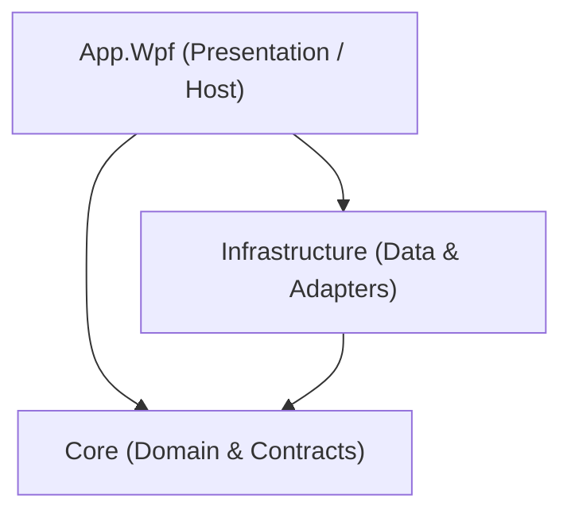

# Architecture

## Layer Responsibilities

### Dependency Direction
- **App.Wpf -> Core**
- **App.Wpf -> Infrastructure**
- **Infrastructure -> Core**
- **Core** has zero references to external layers, UI frameworks, or Infrastructure.

---

### Layer Overview

1. **`src/Core/`**
   - **Responsibility**: Pure domain models, value objects, business logic, and repository/service interfaces.
   - **Dependencies**: None (pure .NET standard/runtime library). No dependency on WPF, UI, or Infrastructure.

2. **`src/Infrastructure/`**
   - **Responsibility**: Data persistence, file I/O, secure credential storage, and external adapters implementing interfaces defined in Core.
   - **Dependencies**: References `Core`.

3. **`src/App.Wpf/`**
   - **Responsibility**: User interface, MVVM view models, views, theme styling (WPF-UI), DI container composition root, Serilog logging bootstrap, and application lifecycle.
   - **Dependencies**: References `Core` and `Infrastructure`.

4. **`tests/Core.Tests/`**
   - **Responsibility**: Unit tests exercising core domain types, value objects, and business rules using xUnit and NSubstitute.
   - **Dependencies**: References `Core`.
