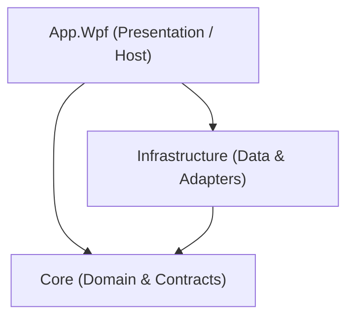

# Architecture

## Layer Responsibilities

### Dependency Direction
- **App.Wpf -> Core**
- **App.Wpf -> Infrastructure**
- **Infrastructure -> Core**
- **Core** has zero references to external layers, UI frameworks, or Infrastructure.

---

### Layer Overview

1. **`src/Core/`**
   - **Responsibility**: Pure domain models (`AccountId`, `SecretValue`, `Account`), domain validation (`AccountValidator`), storage contracts (`IAccountStore`), and domain exceptions (`VaultCorruptedException`).
   - **Dependencies**: None. Pure .NET standard/runtime library.

2. **`src/Infrastructure/`**
   - **Responsibility**: Encrypted file persistence (`EncryptedFileVault`), internal DTO mapping (`AccountDto`), DPAPI key wrapping, and AES-256-GCM authenticated encryption.
   - **Dependencies**: References `Core`.

3. **`src/App.Wpf/`**
   - **Responsibility**: WPF UI shell, MVVM view models (`AccountsViewModel`), Views & Controls (`AccountsPage`, `AccountEditorControl`), dialogs (`IContentDialogService`), notifications (`ISnackbarService`), and DI bootstrapping.
   - **Dependencies**: References `Core` and `Infrastructure`.

4. **`tests/Core.Tests/`**
   - **Responsibility**: Unit tests exercising core domain types, value objects, and business validation rules.
   - **Dependencies**: References `Core`.

5. **`tests/Infrastructure.Tests/`**
   - **Responsibility**: Integration tests verifying DPAPI wrapping, AES-GCM encryption round-trip, backup generation, and corruption/tamper detection.
   - **Dependencies**: References `Core` and `Infrastructure`.

---

### Milestone Status
- **M0**: Scaffolding, solution structure, build pipeline & analyzers. (Completed)
- **M1**: Encrypted account vault + Account list UI + In-dialog editing & validation. (Completed)
- **M2**: Roblox API integration, cookie validation & user profile retrieval. (Next)
