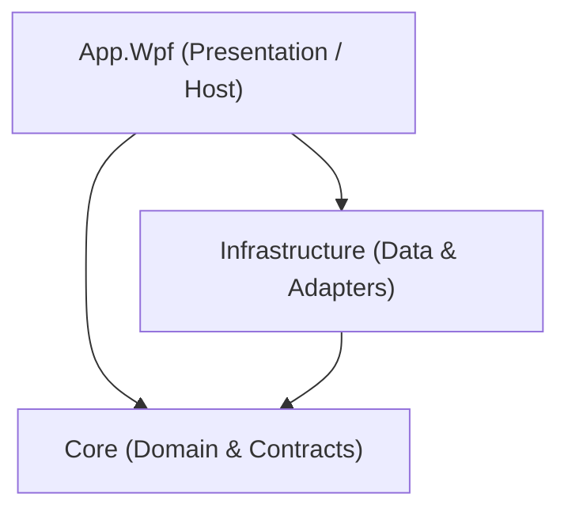

# Architecture

## Layer Responsibilities

### Dependency Direction
- **App.Wpf -> Core**
- **App.Wpf -> Infrastructure**
- **Infrastructure -> Core**
- **Core** has zero references to external layers, UI frameworks, or Infrastructure.

---

### Layer Overview

1. **`src/Core/`**
   - **Responsibility**: Pure domain models (`AccountId`, `SecretValue`, `Account`, `RobloxUser`, `LaunchRequest`, `ServerInfo`, `ServerPage`, `RunningSession`, `ProcessSnapshot`), domain validation (`AccountValidator`, `LaunchRequest.Validate`), storage and service contracts (`IAccountStore`, `IRobloxAuthService`, `ILauncher`, `IServerBrowserService`, `ISessionTracker`, `IProcessProvider`, `IInstanceGate`), and policies (`RejoinPolicy`).
   - **Dependencies**: None. Pure .NET standard/runtime library.

2. **`src/Infrastructure/`**
   - **Responsibility**: Encrypted file persistence (`EncryptedFileVault`), internal DTO mapping (`AccountDto`), DPAPI key wrapping, AES-256-GCM authenticated encryption, Roblox HTTP client pipeline (`RobloxHostGuardHandler`, `RobloxCsrfHandler`, `RobloxRetryHandler`), Roblox authentication service (`RobloxAuthService`), game launcher (`RobloxLauncher`, `RobloxUriBuilder`), server browser service (`ServerBrowserService`), process provider (`SystemProcessProvider`), and background session tracker (`SessionTracker`).
   - **Dependencies**: References `Core`.

3. **`src/App.Wpf/`**
   - **Responsibility**: WPF UI shell, MVVM view models (`AccountsViewModel`, `ServersViewModel`, `RunningViewModel`), Views & Controls (`AccountsPage`, `ServersPage`, `RunningPage`, `AccountEditorControl`, `LaunchDialogControl`, `AccountPickerControl`), Windows (`LoginWindow` with WebView2), dialogs (`IContentDialogService`), notifications (`ISnackbarService`), and DI bootstrapping.
   - **Dependencies**: References `Core` and `Infrastructure`.

4. **`tests/Core.Tests/`**
   - **Responsibility**: Unit tests exercising core domain types, value objects, business validation rules, auto-rejoin policies (`RejoinPolicyTests`), and architecture boundaries (`ArchitectureTests` enforcing `SecretValue.Reveal` allowlist).
   - **Dependencies**: References `Core`.

5. **`tests/Infrastructure.Tests/`**
   - **Responsibility**: Integration and security tests verifying DPAPI wrapping, AES-GCM encryption round-trip, backup generation, tamper detection, HTTP handlers, Roblox authentication flows, URI construction, server browser parsing and retry, session tracking and auto-rejoin lifecycle, and log leak prevention (`LogLeakTests`).
   - **Dependencies**: References `Core` and `Infrastructure`.

---

### Milestone Status
- **M0**: Scaffolding, solution structure, build pipeline & analyzers. (Completed)
- **M1**: Encrypted account vault + Account list UI + In-dialog editing & validation. (Completed)
- **M1.1**: Test isolation from real user paths. (Completed)
- **M2**: Roblox authentication, WebView2 login, cookie validation, game launcher, security guard tests. (Completed)
- **M3**: Server browser, process monitor, running sessions, auto-rejoin. (Completed)
- **M4**: Settings, multi-instance, group management, encrypted backup. (Next)
