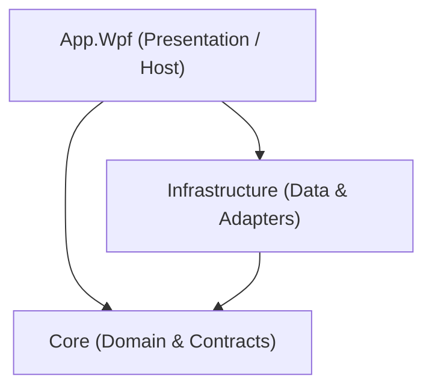
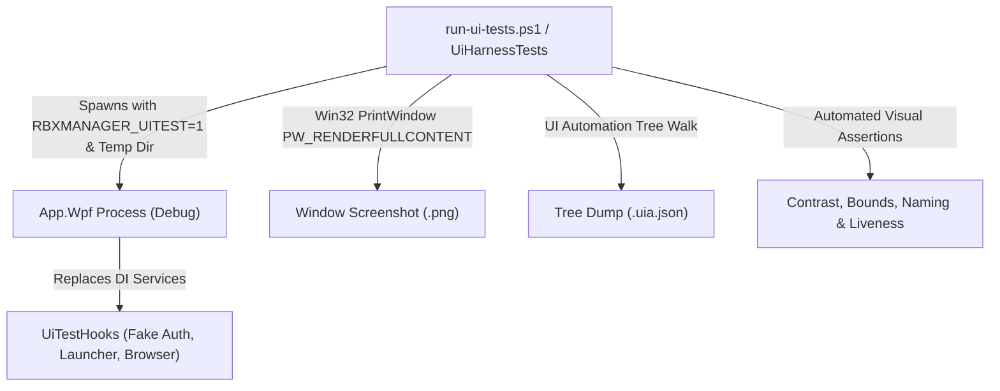

# Architecture

## Layer Responsibilities

### Dependency Direction
- **App.Wpf -> Core**
- **App.Wpf -> Infrastructure**
- **Infrastructure -> Core**
- **Core** has zero references to external layers, UI frameworks, or Infrastructure.

---

### Layer Overview

1. **`src/Core/`**
   - **Responsibility**: Pure domain models (`AccountId`, `SecretValue`, `Account`, `RobloxUser`, `LaunchRequest`, `ServerInfo`, `ServerPage`, `RunningSession`, `ProcessSnapshot`, `AppSettings`), domain validation (`AccountValidator`, `LaunchRequest.Validate`, `AppSettings.Clamp`), storage and service contracts (`IAccountStore`, `IRobloxAuthService`, `ILauncher`, `IServerBrowserService`, `ISessionTracker`, `IProcessProvider`, `IMemoryOptimizer`, `IRobloxLogWatcher`, `IInstanceGate`, `ISettingsService`, `IBackupService`), and policies (`RejoinPolicy`).
   - **Dependencies**: None. Pure .NET standard/runtime library.

2. **`src/Infrastructure/`**
   - **Responsibility**: Encrypted file persistence (`EncryptedFileVault` Format v2 with Argon2id and v1 fallback), `VaultKeyProvider`, internal DTO mapping (`AccountDto`), DPAPI key wrapping, AES-256-GCM authenticated encryption, Roblox HTTP client pipeline (`RobloxHostGuardHandler`, `RobloxCsrfHandler`, `RobloxRetryHandler`, `RobloxHttpClientFactory`), Roblox authentication service (`RobloxAuthService`), game launcher (`RobloxLauncher`, `RobloxUriBuilder`) with unified launch pacing gate (`LaunchDelaySeconds`), server browser service (`ServerBrowserService`), process provider (`SystemProcessProvider`), window controller and background resource optimizer (`WindowController`, `BackgroundWindowThrottler`), smart RAM cleaner (`WindowsMemoryOptimizer`, `RamCleanerService`), ghost disconnect detector (`RobloxLogWatcher` strictly tailing on-disk logs without process memory inspection), background session tracker with smart server hopping auto-rejoin (`SessionTracker`), settings service (`SettingsService`), multi-instance gate (`NamedMutexInstanceGate`), encrypted backup service (`EncryptedBackupService`), and logging redaction enricher (`RobloxSecretRedactionEnricher`).
   - **Dependencies**: References `Core`.

3. **`src/App.Wpf/`**
   - **Responsibility**: WPF UI shell, design tokens (`Themes/Tokens.xaml`), theme engine (`ThemeTokens`), window state restoration and screen-bounds clamping (`UiState`), MVVM view models (`AccountsViewModel`, `AddAccountViewModel`, `ServersViewModel`, `RunningViewModel`, `SettingsViewModel`, `DiagnosticsViewModel`), Views & Controls (`AccountsPage` with bulk launch queue & countdown, `ServersPage`, `RunningPage`, `SettingsPage` with launch delay pacing slider, `DiagnosticsPage`, `AccountEditorControl`, `MasterPasswordSetupControl`), Windows (`MainWindow`, `AddAccountWindow`, `MasterPasswordWindow`), dialogs (`IContentDialogService`), notifications (`ISnackbarService`), and DI bootstrapping.
   - **Dependencies**: References `Core` and `Infrastructure`.

4. **`tests/Core.Tests/`**
   - **Responsibility**: Unit tests exercising core domain types, value objects, business validation rules, auto-rejoin policies (`RejoinPolicyTests`), settings clamping (`AppSettingsTests`), `UiStateSettings` serialization and screen-boundary clamping, `RelativeTimeFormatter` boundary calculations, `DebounceDispatcher` timing, and architecture boundaries (`ArchitectureTests` enforcing strict 5-caller `SecretValue.Reveal` allowlist: `EncryptedFileVault.cs`, `EncryptedBackupService.cs`, `RobloxAuthService.cs`, `RobloxLauncher.cs`, `AccountEditorViewModel.cs`).
   - **Dependencies**: References `Core`.

5. **`tests/Infrastructure.Tests/`**
   - **Responsibility**: Integration and security tests verifying DPAPI wrapping, AES-GCM encryption round-trip, backup generation, tamper detection, HTTP handlers, Roblox authentication flows, URI construction, diagnostics report sanitization, server browser parsing and retry, session tracking and auto-rejoin lifecycle, settings persistence and clamping, named mutex instance gate, encrypted backup PBKDF2/AES-GCM export and import, log leak prevention (`LogLeakTests`), XAML scan tests (`XamlScanTests`), and localization audits (`LocalizationAuditTests`, `I18nParityTests`).
   - **Dependencies**: References `Core` and `Infrastructure`.

6. **`tests/App.Wpf.Tests/`**
   - **Responsibility**: WPF UI unit and safety tests, XAML accessibility scanning (`XamlAccessibilityTests`), and release configuration safety guards (`ReleaseConfigurationSafetyTests`) ensuring zero debug hooks leak into production assemblies.
   - **Dependencies**: References `App.Wpf`, `Core`, and `Infrastructure`.

7. **`tests/App.UiTests/`**
   - **Responsibility**: End-to-end sandboxed UI automation harness (Category `UI`). Drives the application with throwaway directories, fake accounts, offline mocks, and window-only PNG capture (`PW_RENDERFULLCONTENT`). Validates visual bounds, element naming, contrast, and dumps UIA accessibility trees without taking whole desktop control.
   - **Dependencies**: Built on .NET Windows Automation and Win32 interop. References `App.Wpf`, `Core`, and `Infrastructure`.

---

## Sandboxed UI Automation Harness (M16)

### Debug-Only Hook Architecture
1. **Compilation Guard**:
   - All test hooks, mock services, and environment variable handlers (`RBXMANAGER_DATA_DIR`, `RBXMANAGER_UITEST`) are guarded by `#if DEBUG` directives in `App.xaml.cs`, `MainWindow.xaml.cs`, and `UiTestHooks.cs`.
   - In `Release` builds, none of this code compiles into the binary. This is verified by `ReleaseConfigurationSafetyTests` inspecting PE metadata for forbidden keywords.
2. **Directory & Process Isolation**:
   - `RBXMANAGER_DATA_DIR` isolates storage, logs, and settings to a unique throwaway directory. A strict check aborts execution if `RBXMANAGER_DATA_DIR` points to or within `%LOCALAPPDATA%\RbxManager`.
   - Uses test mutex `Local\RbxManager_Application_UiTest_Mutex` to ensure independence from running instances.
3. **Window-Only Native Capture**:
   - The harness invokes Win32 `PrintWindow` with `PW_RENDERFULLCONTENT` (0x02) targeted at the application HWND.
   - In UI test mode, `RenderOptions.ProcessRenderMode = RenderMode.SoftwareOnly;` is set so hardware-composed WPF surfaces render directly to GDI contexts without black-screen artifacts in headless or virtual environments.
   - No whole-desktop capture or screen recording tools are ever used.

---

### Milestone Status
- **M0**: Scaffolding, solution structure, build pipeline & analyzers. (Completed)
- **M1**: Encrypted account vault + Account list UI + In-dialog editing & validation. (Completed)
- **M1.1**: Test isolation from real user paths. (Completed)
- **M2**: Roblox authentication, WebView2 login, cookie validation, game launcher, security guard tests. (Completed)
- **M3**: Server browser, process monitor, running sessions, auto-rejoin. (Completed)
- **M4**: Settings, multi-instance, group management, encrypted backup. (Completed)
- **M5**: Hardening, packaging, and final documentation. (Completed)
- **M6**: Multi-instance real gate, Reveal() surface reduction, report reconciliation, review bundle. (Completed)
- **M7**: Diagnostics page, redacted report generator, customizable launch templates, code health pass. (Completed)
- **M8**: UI/UX polish, design tokens, virtualized high-density DataGrid, relative time formatting, UiState persistence, localization diacritics audit. (Completed)
- **M9**: Code-review closure (tracked Backup source/tests, clean-clone verification, AuthFailureDetails & CSRF diagnosis, token-wide redaction & path username masking, HTTP redirect hardening, cookie memory hygiene, login folder cleanup, Core/Infra localization decoupling). (Completed)
- **M10**: Master Password (Argon2id Format v2 live vault), Per-Account HTTP/SOCKS5 Proxy, Background Roblox Process Resource Optimization (Win32 throttling). (Completed)
- **M11**: Smart RAM Cleaner (Background Working Set Memory Optimization via `SetProcessWorkingSetSize`, periodic `RamCleanerService`, UI toggle & interval slider). (Completed)
- **M12**: Smart Auto-Rejoin (Intelligent public server hopping on crash via `IServerBrowserService`, fallback handling, UI toggle). (Completed)
- **M13**: Ghost Disconnect Detector (`RobloxLogWatcher` tailing on-disk logs for disconnection keywords, automatic termination of frozen processes, UI toggle). (Completed)
- **M14**: UI/UX polish, contrast enhancement, and multi-version fixes. (Completed)
- **M14.1**: Resolve illegal Binding on ConverterParameter in ServersPage. (Completed)
- **M14.2**: Robust Roblox Player installation check across multiple registry hives. (Completed)
- **M14.3**: Overhaul DataGrid styles and force dark theme contrast. (Completed)
- **M14.4**: WebView2 login routing through configured account proxy (Superseded & Removed in M17). (Completed)
- **M15**: Tech Lead audit, launch precheck, UI defect fixes, XAML smoke tests. (Completed)
- **M16**: Sandboxed UI automation test harness, window-only capture, UIA dump, visual assertions. (Completed)
- **M17**: Removal of proxy support across all layers, unified launch pacing gate (`LaunchDelaySeconds`, default 20 s), sequential cookie validation (2 s gap), strict 5-file `Reveal()` allowlist. (Completed)
- **M20**: Replaced WebView2 with bulk cookie import (`AddAccountWindow`, `AddAccountViewModel`, `BulkCookieParser`) and native incognito browser launcher (`IncognitoBrowserLauncher`). (Completed)
- **M18**: Live Integration Test Suite (`tests/Infrastructure.LiveTests/`) exercising real `RobloxHttpClientFactory`, `RobloxAuthService`, and `ServerBrowserService` against live Roblox endpoints with explicit opt-in (`RBX_LIVE_TEST_COOKIE`). (Completed)
- **M19**: UAT Live Trace Telemetry (`IUatLogger`, `UatLogger`) intercepting `WindowsProcessStarter.Start`, `WindowController`, `WindowsMemoryOptimizer`, and `SessionTracker` transitions into `Desktop\RbxManager_UAT_Trace.txt` with secret/ticket masking (`***`). (Completed)
