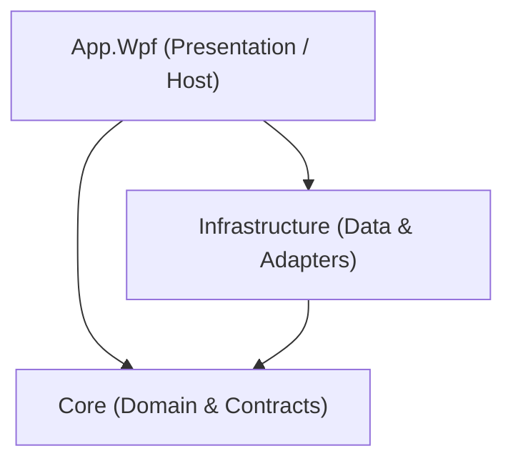

# Architecture

## Layer Responsibilities

### Dependency Direction
- **App.Wpf -> Core**
- **App.Wpf -> Infrastructure**
- **Infrastructure -> Core**
- **Core** has zero references to external layers, UI frameworks, or Infrastructure.

---

### Layer Overview

1. **`src/Core/`**
   - **Responsibility**: Pure domain models (`AccountId`, `SecretValue`, `Account`, `RobloxUser`, `LaunchRequest`, `ServerInfo`, `ServerPage`, `RunningSession`, `ProcessSnapshot`, `AppSettings`), domain validation (`AccountValidator`, `LaunchRequest.Validate`, `AppSettings.Clamp`), storage and service contracts (`IAccountStore`, `IRobloxAuthService`, `ILauncher`, `IServerBrowserService`, `ISessionTracker`, `IProcessProvider`, `IMemoryOptimizer`, `IRobloxLogWatcher`, `IInstanceGate`, `ISettingsService`, `IBackupService`), and policies (`RejoinPolicy`).
   - **Dependencies**: None. Pure .NET standard/runtime library.

2. **`src/Infrastructure/`**
   - **Responsibility**: Encrypted file persistence (`EncryptedFileVault` Format v2 with Argon2id and v1 fallback), `VaultKeyProvider`, internal DTO mapping (`AccountDto`, `ProxyDto`), DPAPI key wrapping, AES-256-GCM authenticated encryption, Roblox HTTP client pipeline (`RobloxHostGuardHandler`, `RobloxCsrfHandler`, `RobloxRetryHandler`, `RobloxHttpClientFactory`), per-account HTTP/SOCKS5 proxy configuration, Roblox authentication service (`RobloxAuthService`), game launcher (`RobloxLauncher`, `RobloxUriBuilder`), server browser service (`ServerBrowserService`), process provider (`SystemProcessProvider`), window controller and background resource optimizer (`WindowController`, `BackgroundWindowThrottler`), smart RAM cleaner (`WindowsMemoryOptimizer`, `RamCleanerService`), ghost disconnect detector (`RobloxLogWatcher` strictly tailing on-disk logs without process memory inspection), background session tracker with smart server hopping auto-rejoin (`SessionTracker`), settings service (`SettingsService`), multi-instance gate (`NamedMutexInstanceGate`), encrypted backup service (`EncryptedBackupService`), and logging redaction enricher (`RobloxSecretRedactionEnricher`).
   - **Dependencies**: References `Core`.

3. **`src/App.Wpf/`**
   - **Responsibility**: WPF UI shell, design tokens (`Themes/Tokens.xaml`), theme engine (`ThemeTokens`), window state restoration and screen-bounds clamping (`UiState`), MVVM view models (`AccountsViewModel`, `ServersViewModel`, `RunningViewModel`, `SettingsViewModel`, `DiagnosticsViewModel`), Views & Controls (`AccountsPage`, `ServersPage`, `RunningPage`, `SettingsPage`, `DiagnosticsPage`, `AccountEditorControl` with Proxy tab, `MasterPasswordSetupControl`), Windows (`MainWindow`, `LoginWindow`, `MasterPasswordWindow`), dialogs (`IContentDialogService`), notifications (`ISnackbarService`), and DI bootstrapping.
   - **Dependencies**: References `Core` and `Infrastructure`.

4. **`tests/Core.Tests/`**
   - **Responsibility**: Unit tests exercising core domain types, value objects, business validation rules, auto-rejoin policies (`RejoinPolicyTests`), settings clamping (`AppSettingsTests`), `UiStateSettings` serialization and screen-boundary clamping, `RelativeTimeFormatter` boundary calculations, `DebounceDispatcher` timing, and architecture boundaries (`ArchitectureTests` enforcing strict 5-caller `SecretValue.Reveal` allowlist).
   - **Dependencies**: References `Core`.

5. **`tests/Infrastructure.Tests/`**
   - **Responsibility**: Integration and security tests verifying DPAPI wrapping, AES-GCM encryption round-trip, backup generation, tamper detection, HTTP handlers, Roblox authentication flows, URI construction, diagnostics report sanitization, server browser parsing and retry, session tracking and auto-rejoin lifecycle, settings persistence and clamping, named mutex instance gate, encrypted backup PBKDF2/AES-GCM export and import, log leak prevention (`LogLeakTests`), XAML scan tests (`XamlScanTests`), and localization audits (`LocalizationAuditTests`, `I18nParityTests`).
   - **Dependencies**: References `Core` and `Infrastructure`.

---

### Milestone Status
- **M0**: Scaffolding, solution structure, build pipeline & analyzers. (Completed)
- **M1**: Encrypted account vault + Account list UI + In-dialog editing & validation. (Completed)
- **M1.1**: Test isolation from real user paths. (Completed)
- **M2**: Roblox authentication, WebView2 login, cookie validation, game launcher, security guard tests. (Completed)
- **M3**: Server browser, process monitor, running sessions, auto-rejoin. (Completed)
- **M4**: Settings, multi-instance, group management, encrypted backup. (Completed)
- **M5**: Hardening, packaging, and final documentation. (Completed)
- **M6**: Multi-instance real gate, Reveal() surface reduction, report reconciliation, review bundle. (Completed)
- **M7**: Diagnostics page, redacted report generator, customizable launch templates, code health pass. (Completed)
- **M8**: UI/UX polish, design tokens, virtualized high-density DataGrid, relative time formatting, UiState persistence, localization diacritics audit. (Completed)
- **M9**: Code-review closure (tracked Backup source/tests, clean-clone verification, AuthFailureDetails & CSRF diagnosis, token-wide redaction & path username masking, HTTP redirect hardening, cookie memory hygiene, login folder cleanup, Core/Infra localization decoupling). (Completed)
- **M10**: Master Password (Argon2id Format v2 live vault), Per-Account HTTP/SOCKS5 Proxy, Background Roblox Process Resource Optimization (Win32 throttling). (Completed)
- **M11**: Smart RAM Cleaner (Background Working Set Memory Optimization via `SetProcessWorkingSetSize`, periodic `RamCleanerService`, UI toggle & interval slider). (Completed)
- **M12**: Smart Auto-Rejoin (Intelligent public server hopping on crash via `IServerBrowserService`, fallback handling, UI toggle). (Completed)
- **M13**: Ghost Disconnect Detector (`RobloxLogWatcher` tailing on-disk logs for disconnection keywords, automatic termination of frozen processes, UI toggle). (Completed)
